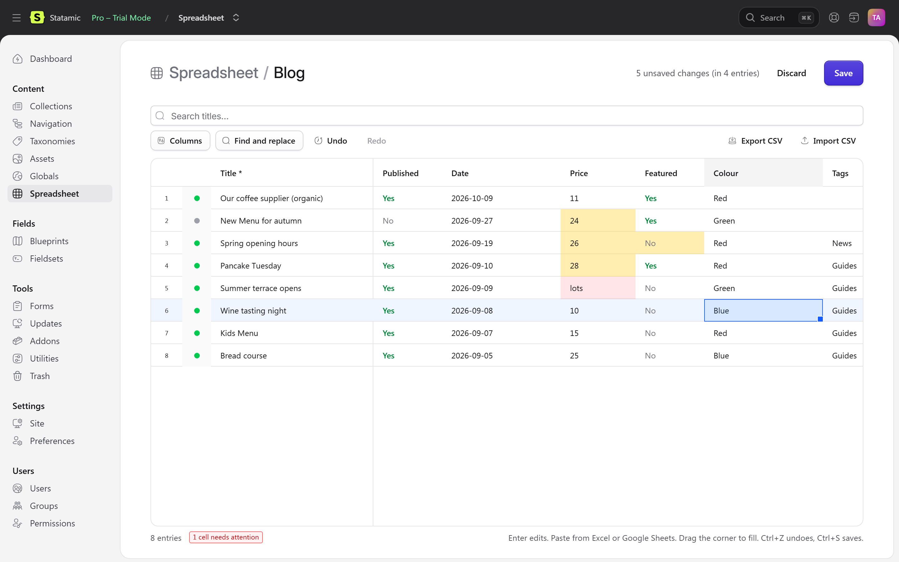

# Karelia Spreadsheet

Edit Statamic entries in a spreadsheet. **[Product page](https://ziroxonline111.github.io/karelia-labs/products/karelia-spreadsheet/)** · [Documentation](https://ziroxonline111.github.io/karelia-labs/products/karelia-spreadsheet/docs/) · [Support](https://ziroxonline111.github.io/karelia-labs/products/karelia-spreadsheet/support/) · [Security](https://ziroxonline111.github.io/karelia-labs/products/karelia-spreadsheet/security/) · [Privacy](https://ziroxonline111.github.io/karelia-labs/products/karelia-spreadsheet/privacy/) · [EULA](https://ziroxonline111.github.io/karelia-labs/products/karelia-spreadsheet/eula/)

Edit many Statamic entries at once, in a spreadsheet inside the Control Panel. Click a cell and type, paste a block from Excel or Google Sheets, drag to fill down, find and replace across a collection, or round-trip through CSV. Every change is saved through your blueprints' own validation and your users' own permissions.



## Why

Updating a meta description on 200 pages, a price on 80 products or a tag on every post from last year means opening every entry, one at a time. Craft has had inline editing in its listings since version 5, and Shopify has its bulk editor. Statamic has not, until now.

## Features

- **A real spreadsheet.** Arrow keys, Enter to edit, Tab, range selection, copy and paste with Excel and Google Sheets, a fill handle, column resizing, and a pinned title column.
- **The right editor for each field.** Text, textareas and Markdown, slugs, numbers, dates, toggles (Enter flips them), select, radio, button group and checkboxes, and pickers with search for entries, terms, users and assets.
- **Find and replace** in one column or every text column, with match case and whole-cell options and a count before you replace.
- **CSV out and in.** Export the sheet, edit it anywhere, import it back. Rows are matched by ID (or slug), and imported values show up as unsaved changes you can check before saving. Cells that could run as formulas in Excel are written safely.
- **Undo and redo** for every edit, paste, fill, replace and import (Ctrl+Z, Ctrl+Y). Ctrl+S saves.
- **Nothing is saved until you press Save.** Changed cells are highlighted. Values that cannot be right (a word in a number field, an unknown tag) are marked red straight away and not sent.
- **Saved the Statamic way.** Each entry is saved through its blueprint's validation rules, fieldtype processing, revisions (as a working copy where revisions are on) and last-modified tracking, exactly like the publish form. Errors come back on the exact cell.
- **Respects permissions.** Users need the new *Use the spreadsheet* permission. On top of that, they only see entries they can view, can only change entries they can edit, need publish rights to change the status, and cannot change the author unless they may edit other authors' entries.
- **Multi-site aware.** Switch site, and fields that are not localizable are locked on translations.
- **Edit in Spreadsheet** bulk action in every entry listing: select entries, open just those.
- Dark mode, small screens, keyboard only.

Fields the spreadsheet cannot edit (Bard, Replicator, Grid, Table and similar) are shown read-only for reference. Edit those on the entry page.

## Requirements

- Statamic 6.20 or later
- PHP 8.3 or later
- Works with Statamic Core and Pro. Roles and permissions are a Pro feature, so on Core only the super admin uses it.

## Installation

```bash
composer require karelialabs/statamic-spreadsheet
```

**Spreadsheet** appears under **Content** in the Control Panel for super admins. To let other roles use it, tick **Use the spreadsheet** under **Users → Roles**.

## Using it

1. Open **Content → Spreadsheet** and pick a collection, or select entries in any listing and choose **Edit in Spreadsheet**.
2. Edit:
   - **Type:** select a cell and start typing, or press Enter or double-click. Enter saves the cell, Esc cancels.
   - **Paste:** copy cells in Excel or Google Sheets, select the top-left cell and press Ctrl+V. Yes/no, true/false and 1/0 all work for toggles. Option labels or values both work. Use `,` between several tags or options.
   - **Fill:** drag the small square at the corner of a selection.
   - **Pick:** press Enter on a select, tag, entry, user or asset cell to open a picker.
3. Press **Save** (or Ctrl+S). Saved cells lose their highlight. Anything that failed stays highlighted in red, with the reason on hover.

Use **Columns** to choose which fields to show. Your choice is remembered per collection in this browser.

### CSV

**Export CSV** downloads the visible columns plus an `id` column. Relationship fields are written as IDs, several values are separated by `, `, and toggles as `yes`/`no`. **Import CSV** reads the same format (comma or semicolon separated, UTF-8). Columns can be named by handle or by label. Rows without a matching entry are skipped and counted. Import never creates or deletes entries.

## Configuration

```bash
php artisan vendor:publish --tag=statamic-spreadsheet-config
```

| Option | Default | What it does |
|---|---|---|
| `limit` | `2000` | Most entries loaded into one sheet (`STATAMIC_SPREADSHEET_LIMIT`). Search or open a selection to edit the rest |

## Good to know

- Field conditions (show/hide rules) are not applied in the grid. Every field in the blueprint is shown, and validation rules still apply when saving.
- Pasted relationship values must be IDs (or term slugs for single-taxonomy fields). Use the picker to search by title.
- The grid loads only when a spreadsheet is opened, so the rest of the Control Panel is not slowed down.

## Support

Email **support@karelialabs.atlassian.net** with your Statamic version and the addon version. Questions and bug reports are welcome.

## Licence

Commercial. A licence from the Statamic Marketplace covers one production site; development and staging copies are free. See [LICENSE.md](LICENSE.md) and the [end user licence agreement](https://ziroxonline111.github.io/karelia-labs/products/karelia-spreadsheet/eula/). The grid is built on [RevoGrid](https://github.com/revolist/revogrid) (MIT). See [THIRD-PARTY-NOTICES.md](THIRD-PARTY-NOTICES.md).
